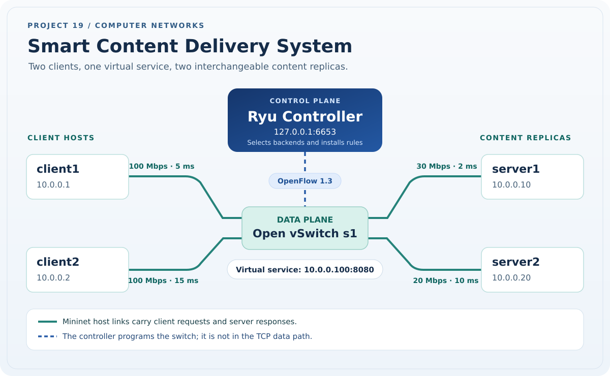

# Smart Content Delivery System (SDN + TCP sockets)

Clients request content from **one virtual IP**. A Ryu (OpenFlow 1.3) controller
picks a content server for every TCP connection based on server health, link
utilisation, active connections and delay, and rewrites the flows in the switch
so the client never knows which replica answered. If a server or its link fails,
new TCP connections can reach the surviving server.

## Topology



The dashed line is the **OpenFlow control connection**. The solid lines are
Mininet host links. Clients send TCP requests to `10.0.0.100:8080`; `s1`
rewrites and forwards those packets to the selected backend. The controller
installs the rules but is not in the TCP data path.

## Files

| File | Purpose |
|---|---|
| `controller.py` | Ryu app: VIP ARP, server selection, flow rewriting, heartbeat/port-status/stat monitoring, failover |
| `topo.py` | Mininet topology, starts servers, interactive CLI or automated experiments |
| `server_socket.py` | Multi-threaded TCP content server + UDP heartbeat sender |
| `client_socket.py` | TCP client: retries, parallel workers, latency/throughput metrics |
| `compare.py` | Prints static-baseline vs dynamic results |

## How it works

1. **Discovery / availability (socket -> SDN):** each server broadcasts a UDP
   heartbeat `{"name","active"}` every second. The switch sends it to the
   controller (packet-in), which learns the server's MAC, IP and switch port.
   No heartbeat for 3 s => server DOWN. Link-down port events mark it DOWN instantly.
2. **Monitoring:** the controller polls port statistics every second and
   computes the content rate of each server link (utilisation).
3. **Selection (new TCP connection):** `cost = 1.0*utilisation + 0.1*(conns/weight) + 0.02*delay_ms`,
   lowest cost among alive servers wins.
4. **Dynamic forwarding:** two flows per connection are installed:
   client->VIP rewritten to server, server->client rewritten back to VIP.
5. **Recovery:** when a server goes DOWN its flows are deleted. That server’s
   established TCP connections cannot migrate; the client retries with a new
   socket. A new opening SYN is assigned to a healthy backend in dynamic mode.
6. **Baseline:** `LB_MODE=static` always sends everything to server1 and ignores
   health and load.

## Setup (Ubuntu VM)

```bash
sudo apt update && sudo apt install -y mininet openvswitch-switch python3-pip
pip3 install ryu eventlet==0.30.2      # if pip refuses: add --break-system-packages, or use a venv
sudo service openvswitch-switch start
```
Ryu needs an older Python (3.8-3.10 is safest). On Ubuntu 22.04 it works as above.

## Run: interactive demo

Terminal 1:
```bash
cd ~/smart-content-delivery-sdn
sudo mn -c
ryu-manager --ofp-tcp-listen-port 6653 controller.py
```
Terminal 2:
```bash
cd ~/smart-content-delivery-sdn
sudo python3 topo.py
```
Inside `mininet>`:
```
client1 python3 client_socket.py --count 5
client2 python3 client_socket.py --count 10 --size 2000000 --parallel 4
sh ovs-ofctl -O OpenFlow13 dump-flows s1
link server1 s1 down            # failure: watch controller log + rerouting
client1 python3 client_socket.py --count 5
link server1 s1 up
```

## Run: performance comparison (baseline vs dynamic)

```bash
# 1) baseline
LB_MODE=static ryu-manager --ofp-tcp-listen-port 6653 controller.py  # terminal 1
sudo mn -c && sudo python3 topo.py --experiment --label static   # terminal 2
# stop ryu (Ctrl+C), then 2) dynamic
LB_MODE=dynamic ryu-manager --ofp-tcp-listen-port 6653 controller.py  # terminal 1
sudo mn -c && sudo python3 topo.py --experiment --label dynamic  # terminal 2
# 3) compare
python3 compare.py
```

Scenarios: **normal** (light load), **heavy_load** (2 clients x 4 parallel
downloads), **server1_link_failure** (server1 link dies mid-transfer).
Metrics: success/failed/retried requests, avg and p95 latency, per-request and
aggregate throughput, per-server distribution. Latency for successful retries
includes time spent on earlier attempts. Re-run both modes on the demo VM; the
checked-in JSON is from an earlier revision and not evidence of a fresh run.
The experiment exits on a missing client summary or an incorrect request count.

## Test cases

| # | Test | Expected |
|---|---|---|
| 1 | `client1 ... --count 5` | all OK, `X-Server` shown |
| 2 | heavy parallel downloads | dynamic spreads across both servers; static uses only server1 |
| 3 | `link server1 s1 down` then request | controller logs `SERVER DOWN server1`, requests served by server2 |
| 4 | `link server1 s1 up` | controller logs `SERVER UP server1` after next heartbeat |
| 5 | Stop only the intended replica by its verified PID (optional) | heartbeat timeout marks that replica DOWN after roughly 3–4 s |
| 6 | dump-flows | per-connection rewrite flows (set_field eth/ipv4 dst/src) |

## Troubleshooting

* Use the link-down demo first. Avoid broad `pkill -f` commands: the Mininet
  hosts can share a PID namespace, so both replicas could stop.

* `Switch did not connect`: start `ryu-manager` first; check port 6653 (`--ofp-tcp-listen-port 6653`).
* Leftovers from earlier runs: `sudo mn -c`; make sure `openvswitch-switch` is running.
* Delete the editor backup files (`topo.py.save*`); they are in `.gitignore`.
* Server logs: `/tmp/server1.log`, `/tmp/server2.log` (inside the VM).
